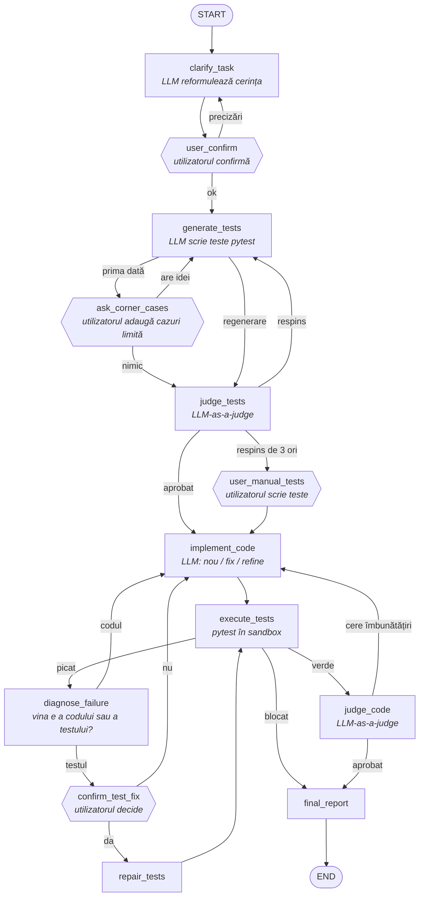

# Agent Asistent de Cod cu Auto-Corecție

Un agent construit cu **LangGraph** care transformă o cerință scrisă în limbaj natural într-un modul Python testat. Lucrează în stil TDD: întâi scrie testele, apoi codul, și se corectează singur până când testele trec. Utilizatorul confirmă cerința la început și intervine pe parcurs doar acolo unde agentul nu poate decide singur.

```
$ python main.py "Scrie o funcție care validează un CNP românesc"
```

## Cum funcționează



Nodurile hexagonale opresc graful cu `interrupt()` și așteaptă răspunsul utilizatorului.

### Fazele

1. **Clarificare.** Agentul reformulează cerința, propune interfața (semnăturile funcțiilor) și își declară presupunerile. Bucla se repetă până când utilizatorul confirmă.
2. **Teste.** Agentul generează o suită pytest, iar utilizatorul o poate completa cu cazuri limită. Un critic LLM evaluează suita (acoperire, valori așteptate corecte). Dacă o respinge de 3 ori, utilizatorul poate adăuga teste manual.
3. **Implementare.** Agentul scrie codul și rulează testele într-un director temporar. Dacă unele pică, decide întâi cine e de vină (vezi mai jos). Când toate trec, un critic de cod verifică lizibilitatea, duplicarea și bug-urile netestate.
4. **Raport.** Salvează în `output/` codul, testele și un raport cu explicația codului și o evaluare critică.

## Decizii de design

**Testele pot fi greșite.** Testele sunt și ele generate de un LLM. La primele rulări, agentul a primit un test care cerea ca CNP-ul `1909010101001` să fie valid, deși luna din el era **90**. Agentul a „reparat” un cod corect până l-a stricat, doar ca să satisfacă testul. De aceea, înainte de orice reparare, nodul `diagnose_failure` stabilește pentru fiecare test picat dacă vina e a codului sau a testului. Testele se modifică doar cu acordul utilizatorului, altfel agentul ar putea „trișa” rescriind testele ca să treacă.

**Limite pentru fiecare tip de buclă.** Fiecare buclă are contorul ei, cu o limită care se poate configura:
- respingeri ale criticului de teste;
- rulări picate în total;
- de câte ori la rând poate pica **același** test (semn că agentul nu înaintează);
- runde de îmbunătățire cerute de criticul de cod;
- corectări ale testelor.

**Ultima versiune care trecea testele nu se pierde.** Dacă o îmbunătățire cerută de critic strică testele și agentul se oprește, se livrează ultima versiune a codului care trecea toate testele.

**Nodurile care cer input nu apelează LLM-ul.** Când graful e reluat după `interrupt()`, LangGraph rulează din nou nodul întrerupt de la început. Un apel LLM pus în același nod s-ar repeta, așa că un nod fie întreabă utilizatorul, fie apelează LLM-ul, niciodată ambele.

**Răspunsuri structurate pentru critici, text simplu pentru cod.** Verdictele vin ca obiecte Pydantic validate (`with_structured_output`). Codul e cerut ca text într-un bloc ` ```python ``` `, pentru că modelele greșesc mai des când trebuie să pună cod lung în interiorul unui JSON.

**Rezistent la limitele planului gratuit Groq.** Când modelul principal își epuizează cota zilnică, agentul trece automat la un model de rezervă. Starea se salvează în SQLite după fiecare nod, deci o rulare întreruptă continuă cu `--resume`.

## Structura proiectului

```
main.py            interfața CLI: rulează graful, pune întrebările, --resume
graph.py           nodurile și muchiile grafului
routers.py         muchiile condiționate (doar citesc starea)
state.py           AgentState (TypedDict) și starea inițială
schemas.py         scheme Pydantic pentru răspunsurile structurate ale LLM-ului
llm.py             singurul modul care vorbește cu LLM-ul (cu modele de rezervă)
config.py          setări din .env (model, limite, timeout)
persistence.py     checkpointer SQLite pentru reluarea rulărilor
node_names.py      numele nodurilor (StrEnum)
nodes/             câte un fișier pentru fiecare nod
utils/             sandbox pytest, interacțiunea cu utilizatorul, formatare text
tests/             testele agentului (fără apeluri LLM reale)
```

## Instalare și rulare

Cerințe: Python 3.11+ și o cheie API [Groq](https://console.groq.com/keys). Cheia gratuită e suficientă.

```bash
python -m venv .venv && source .venv/bin/activate
pip install -r requirements.txt
cp .env.example .env          # completează GROQ_API_KEY

python main.py "Scrie o funcție care validează un CNP românesc"
python main.py --resume       # continuă ultima rulare întreruptă
```

Toate setările se pot schimba din `.env` (vezi `.env.example`). Cele mai importante:

| Variabilă | Implicit | Rol |
|---|---|---|
| `LLM_MODEL` | `openai/gpt-oss-120b` | modelul principal |
| `LLM_FALLBACK_MODELS` | `openai/gpt-oss-20b,qwen/qwen3.8-27b` | modelele folosite când cel principal își epuizează cota zilnică |
| `LLM_REASONING_EFFORT` | `low` | cât „gândesc” modelele gpt-oss; afectează consumul de tokeni |
| `MAX_TEST_JUDGE_ITERATIONS` | `3` | de câte ori poate respinge criticul testele |
| `MAX_FIX_ATTEMPTS` | `5` | rulări picate permise în total |
| `MAX_SAME_TEST_FAILURES` | `3` | de câte ori la rând poate pica același test |
| `MAX_REFINE_ITERATIONS` | `2` | runde de îmbunătățire cerute de criticul de cod |
| `MAX_TEST_REPAIRS` | `2` | corectări permise ale testelor greșite |

## Teste

```bash
python -m pytest
```

Testele nu fac niciun apel LLM real. Acoperă:
- routerele (fiecare ramură a grafului);
- sandbox-ul (cod corect, cod greșit, eroare de sintaxă, buclă infinită oprită de timeout);
- trecerea la modelele de rezervă;
- trei rulări cap-coadă ale grafului, cu un LLM fals și răspunsuri scriptate ale utilizatorului, inclusiv scenariul cu testul greșit.

## Limitări

- **Sandbox-ul nu izolează cu adevărat codul.** Înseamnă doar un director temporar și un timeout: codul generat rulează cu drepturile utilizatorului. Pentru izolare reală ar trebui un container Docker.
- **Criticii LLM nu sunt întotdeauna de încredere.** Pot aproba teste greșite sau respinge cod bun. Modelele de rezervă, mai mici, sunt vizibil mai slabe ca judecători.
- **Un singur modul.** Agentul generează un singur fișier, `solution.py`. Pentru proiecte cu mai multe fișiere ar avea nevoie de un rezumat al proiectului (semnături și docstring-uri) și de editări țintite, nu de rescrierea fișierelor întregi.
- **Interfață doar în linia de comandă.** Datorită `interrupt()`, o interfață web s-ar putea adăuga fără să fie modificate nodurile.
